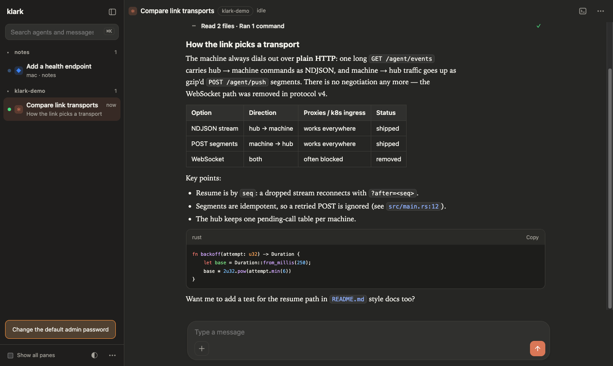

# klark

**A terminal workspace for AI coding agents, and a self-hosted web hub to watch
and answer them from any browser or phone.**

Run Claude Code, Codex, Devin and other agents in persistent klark panes. klark
knows which agent is working, blocked or idle, lets agents message each other
across sessions and machines, and links each machine to **klarkhub**, where your
team reads every agent as a clean, Claude-style chat.



Docs: **https://muthuishere.github.io/klark/**

## What you get

- **Persistent panes.** Agents keep running in a background server when you
  detach. `klark` reattaches; `ctrl+b q` detaches.
- **Folder sessions.** `klark -s` creates or attaches a session named after the
  current folder; `klark -s ~/work/api` uses that folder; `klark -s review`
  uses that name.
- **Agent-aware.** Every agent pane shows working, blocked or idle. Agents can be
  named (`klark msg name reviewer`) and read (`klark transcript`).
- **Agents message agents.** `klark msg send reviewer "please review PR 12"`
  reaches an agent in any session on this machine, or on any other machine
  connected to the same hub (`machine/session/agent`).
- **klarkhub, the web hub (default port 7470).** One self-hosted server (Docker or Kubernetes, plain
  HTTP, SQLite) for many machines and people:
  - a chat for every agent (Claude, Devin, generic agents, plain shells as
    command blocks), markdown and tables rendered, tool calls folded;
  - search across agents, folders and messages (⌘K);
  - click a file path to open it in a GitHub-style viewer and download it
    (10 MB limit, secrets refused);
  - send images from your phone to an agent; agents share files with `klark offer`;
  - sign-in with LDAP / Active Directory or the built-in user directory;
  - machines join by browser approval (`klark hub connect --url …`).
- **Light on load.** Panes stream only while someone is watching. An idle
  machine costs ~1 B/s and no CPU; a 512 MB hub serves 100 machines (measured,
  see docs/experiments).
- **No phoning home.** No self-update, no telemetry, no remote catalogs.

## Quick start

```bash
cargo build --release              # needs Zig 0.16 (for the vendored libghostty-vt)
ln -s "$PWD/target/release/klark" ~/.local/bin/klark
klark -s                           # a session for this folder; start an agent in it
```

Prebuilt Linux binaries come with each tagged release.

## Hub in two steps

1. Run klarkhub (see [deploy guide](docs/deploy.md)):

   ```bash
   docker run -d -p 7470:7470 -v klarkhub-data:/data ghcr.io/muthuishere/klarkhub:latest
   # or: kubectl apply -f deploy/k8s/
   ```

   Open `http://<host>:7470`, sign in as `admin` / `adminadmin`, and change the password.

2. On each machine:

   ```bash
   klark hub connect --url http://<host>:7470   # approve this machine in the browser
   klark hub connect                            # later: reconnect to the default hub
   klark hub stop                               # take this machine off the hub
   klark hub ls | use <name> | rm <name> | status
   ```

## Layout

| path | what |
|---|---|
| `src/` | klark itself (Rust) |
| `crates/klark-link` | the machine side of the hub link (HTTP: NDJSON down, POST up) |
| `hub/` | klarkhub: C# Blazor Server (.NET 10), SQLite, Docker |
| `deploy/k8s/` | example Kubernetes manifest |
| `site/` | the documentation site (`just docs`) |
| `skills/klark` | the skill that teaches agents to use klark |
| `docs/` | design records: [ADRs](docs/README.md), [status](docs/STATUS.md), [experiments](docs/experiments/README.md) |

## Where klark comes from

klark is a fork of **[herdr](https://github.com/herdrdev/herdr)** (Apache-2.0), a
terminal multiplexer for coding agents. klark keeps herdr's core and builds on it.

**From herdr:**
- the terminal multiplexer (server, client, panes, tabs, workspaces, layouts,
  keybindings, copy mode, the libghostty-vt terminal);
- agent detection and the working / blocked / idle states;
- persistent sessions and live handoff across restarts;
- the socket API and its schema, and the agent integrations.

**New in klark:**
- klarkhub, the self-hosted web hub, and the HTTP-only machine link;
- agent-to-agent messaging across sessions and machines (`klark msg`);
- the Claude-style chat view with transformers for Claude, Devin and other agents;
- structured transcripts (Claude Code logs, Devin's session database);
- the file viewer, image upload and `klark offer`;
- LDAP / directory sign-in, browser approval for machines, saved hubs;
- `klark -s` folder sessions and the single `klark` skill.

**Changed from herdr:** self-update, hosted announcements and remote catalogs are
removed. The config folder is `~/.config/klark`; klark never reads or moves
`~/.config/herdr`, so herdr and klark run side by side. Environment variables are
`KLARK_*`, for example `KLARK_SOCKET_PATH`. The version number follows herdr's
(currently 0.9.5).

herdr-expose, the earlier web view for herdr, is a separate product; klarkhub
re-implements its ideas without sharing code (ADR 0008).

## License

Apache-2.0, as herdr.
